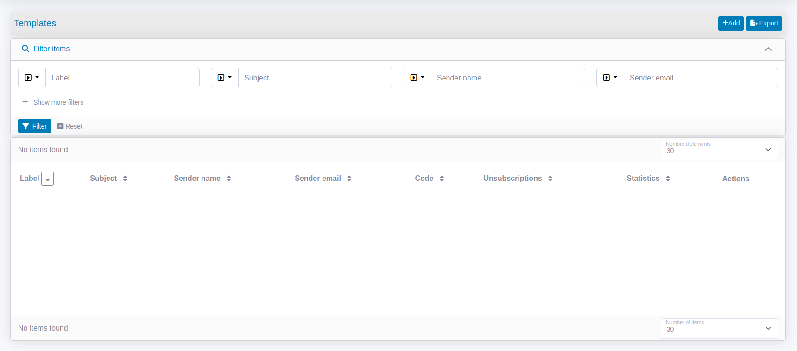
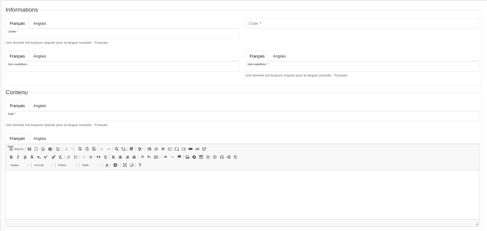

# Mail templating

The following is showing an example how you can create a mail template.

## Create a mail template

1. Go on the templates list page and click on "Add" button


2. Fill the form to create a new template


## Use variables

You can put [Twig](https://twig.symfony.com/) variables, conditions and loops in these fields: `subject`, `text`, `html` and `senderName`.
The variables are replaced by the MailDto and the ContactDto objects when the template is rendered.
Each recipient of each mail use a new render of the template.

A variable looks like this:
```twig
Hello {{ user.fullName }},
Here is the link to reset your password : {{ url }}
```

The variables come from `MailDto::$data` and `ContactDto::$data`. A variable that is not set renders as an empty
string: no exception is thrown.
To add data to your mail, see: [Usage](usage.md "Add data to the mail").

## Allowed Twig (sandbox)

Templates are written from the back office, so they are not compiled with the application Twig environment: they
are rendered by a dedicated environment (`lle_hermes.mail_twig`, class `MailTwigEnvironment`) which has no global
(`app` does not exist), cannot read template files (`include`, `source`) and only knows a short list of extensions.
On top of that, every template is **sandboxed**: only the following constructs are allowed.

| Kind | Allowed by default |
| --- | --- |
| Tags | `if` (with `elseif` / `else`), `for`, `set` |
| Filters | `abs`, `capitalize`, `date`, `default`, `e`, `escape`, `first`, `format`, `join`, `keys`, `last`, `length`, `lower`, `merge`, `nl2br`, `number_format`, `raw`, `replace`, `reverse`, `round`, `slice`, `split`, `striptags`, `title`, `trim`, `upper`, `url_encode`, `format_currency`, `format_date`, `format_datetime`, `format_number`, `format_time`, `trans` |
| Functions | `date`, `max`, `min`, `range`, `path`, `url`, `hermes_has_consent` |
| Tests | `defined`, `empty`, `null`/`none`, `even`, `odd`, `same as`, `divisible by`, `iterable`, `true`… (all but `constant`) |

Mail data are stored as JSON, so every key you pass is readable (`{{ booking.reference }}`). Calling a method or
reading a property of an **object** is refused.

`format_*` filters need `twig/intl-extra` (with `twig/extra-bundle`), `trans` needs the translator, `path`/`url` need
the router: they are only available when the application provides them.

A template using anything else is refused when it is saved (validation error naming the construct) and, if it reaches
the sending anyway, the recipient is put in `error` with the reason (see [Configuration](configuration.md "Retry on
send failure")). To allow more, see [Configuration](configuration.md "Mail templates Twig environment").

## Text version

The text version of the mail is generated automatically from the rendered HTML:
links are kept as `[text](url)`, images are removed and the layout tables are rendered as paragraphs.

The `text` field has been removed from the template and mail forms.
A text set on the template or the mail is now ignored as soon as the mail has an HTML content;
it is only used for mails without HTML.

## Base64 images

If the template contains images base64 encoded, they will be stored on the server and replaced by a classic image in the mail content.
To configure the upload path of the images, see: [Configuration](configuration.md "File storage").

## Override template for multitenant

If multitenant is configured, you can override templates, see: [Multitenant](multitenant.md "Override template").
